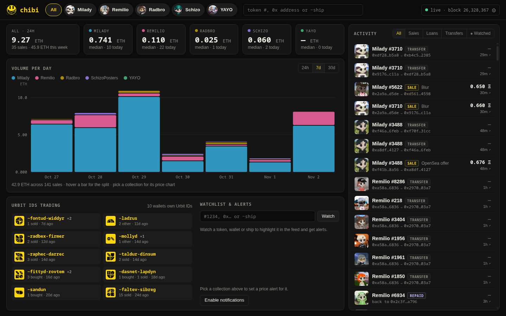
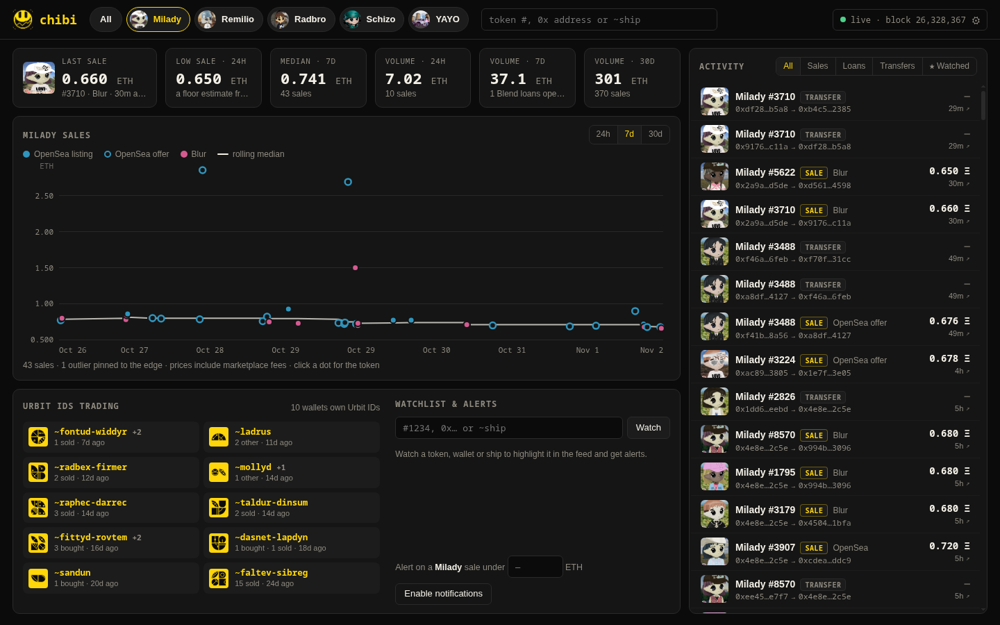
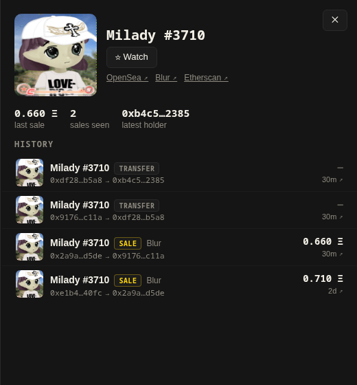
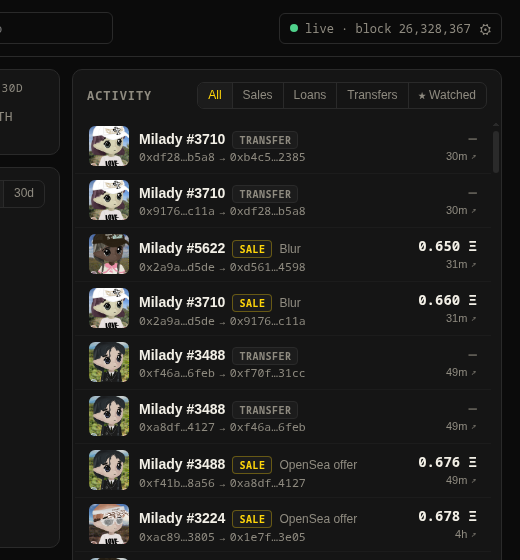
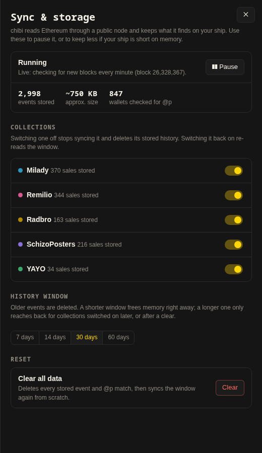

<p align="center">
  
</p>

<h1 align="center">%chibi</h1>

<p align="center">
  Live on-chain activity for Remilia collections, on your Urbit ship.<br>
  Sales with real prices, Blend loans, transfers, and which Urbit IDs are trading.
</p>



## Install

From your ship's dojo:

```
|install ~nosfyl %chibi
```

Or in Landscape: search for `~nosfyl` and click **Get App** on Chibi.

Open it from the tile, or go to `/apps/chibi` on your ship. The first sync reads about 30 days of history, which takes 10–15 minutes. After that it checks for new blocks every minute.

## What it does

Chibi watches five collections on Ethereum:

| Collection | Contract |
|---|---|
| Milady | `0x5af0d9827e0c53e4799bb226655a1de152a425a5` |
| Remilio | `0xd3d9ddd0cf0a5f0bfb8f7fceae075df687eaebab` |
| Radbro | `0xabcdb5710b88f456fed1e99025379e2969f29610` |
| SchizoPosters | `0xbfe47d6d4090940d1c7a0066b63d23875e3e2ac5` |
| YAYO | `0x09f66a094a0070ebddefa192a33fa5d75b59d46b` |

### All collections

- One feed of everything, newest first, filterable by sales, loans, transfers or your watchlist.
- A tile per collection with its 7-day median sale and today's sales count.
- Volume per day (or per hour on 24h), stacked by collection.

### One collection

- **Last sale**, **lowest sale in 24h** (a floor estimate), **7-day median**, and volume over 24h, 7d and 30d.
- A chart of every sale, colored by marketplace, with a rolling median. Hover for the token, click to open it.



### Tokens, wallets and Urbit IDs

- Click any token for its history and links to OpenSea, Blur and Etherscan.
- Wallets that own an Urbit ID show the **@p and sigil** instead of a 0x address. Chibi matches owner addresses against your ship's own Azimuth state, so no outside lookup is involved.
- **Urbit IDs trading** lists every wallet in the activity that owns a point, with what it bought and sold.
- Search by token number, `0x` address or `~ship`.

| A token | A wallet with an Urbit ID |
|---|---|
|  |  |

### Watchlist and alerts

Watch tokens, wallets or ships to highlight them in the feed. Set a "sale under X ETH" alert per collection. With notifications enabled, the browser alerts you while Chibi is open in a tab.

### Sync and storage

Click the sync status in the top-right corner to open the controls:

- **Pause / Resume** stops all fetching but keeps what's stored.
- **Switch collections off** you don't care about. This stops syncing them and deletes their stored history.
- **History window**: 7, 14, 30 or 60 days. Older events are deleted, so a smaller window keeps your ship lighter.
- **Clear all data** wipes everything and syncs again from scratch.

Thirty days of all five collections is a few thousand events, around 1 MB.



## How prices are read

Everything comes from the chain; there are no API keys. For every transfer of a watched token, Chibi fetches the transaction receipt and decodes the marketplace event in it:

| Venue | Event | Shown as |
|---|---|---|
| OpenSea (Seaport 1.5 / 1.6) | `OrderFulfilled` | a sale. A listing if the NFT was offered; an accepted **offer** if it was asked for. |
| Blur | `Execution721Packed` and its fee variants | a sale; the price is packed into the event |
| Blend | `LoanOfferTaken`, `Repay`, `Seize` | a loan, repayment or seizure, not a sale |
| anything else | – | a transfer with no price |

Prices include marketplace fees. Listings live off-chain, so there's no true floor price; the lowest recent sale stands in for it.

Chibi talks to Ethereum through the public node `rpc.mevblocker.io`, over your ship's own HTTP client.

## How it works

| Piece | |
|---|---|
| `desk/app/chibi.hoon` | The agent. Polls the node over iris, decodes receipts, stores activity, matches owners to Urbit IDs, and serves the page and an owner-only JSON API. Collections are listed in its `collections` arm. |
| `desk/web/app.js` | The dashboard: stats, charts, feed, drawers, watchlist and the sync controls. |
| `desk/web/sigil.js` | [@urbit/sigil-js](https://github.com/urbit/sigil-js) 2.2.0 (MIT), vendored. |

### API

All routes are under `/apps/chibi/api` and need you to be logged in to your ship.

| Route | |
|---|---|
| `GET /state` | sync status, recent activity, every stored sale, @p matches, settings |
| `GET /find?q=` | activity for a token id, `0x` address or `~ship` |
| `POST /control` | `{action: "pause" \| "resume" \| "clear"}`, `{action: "toggle", coll}`, `{action: "days", days}` |
| `POST /settings` | watchlist and alert rules (JSON, up to 8 kB) |

## Development

On a fake ship or comet:

```
|new-desk %chibi, =gall &
|mount %chibi
```

Then `./dev.sh <pier-dir> <tmux-session>` copies `desk/` in and commits it, and `|install our %chibi` starts it.

To add a collection, append it to the `collections` arm in the agent and add its image URL to `IMG` (or `META`) in `app.js`.

## License

MIT. See [LICENSE](LICENSE).
